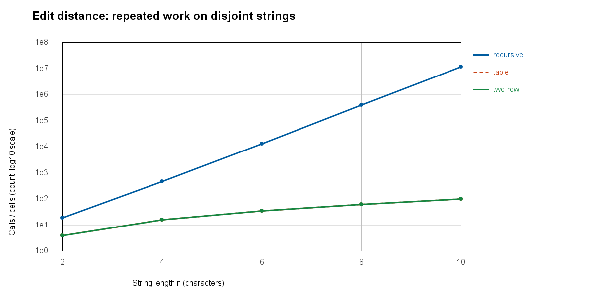
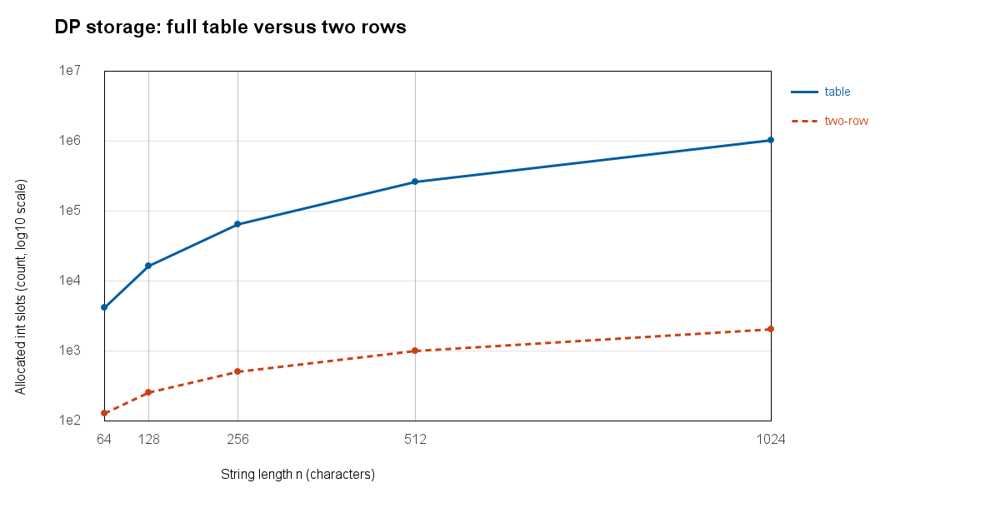
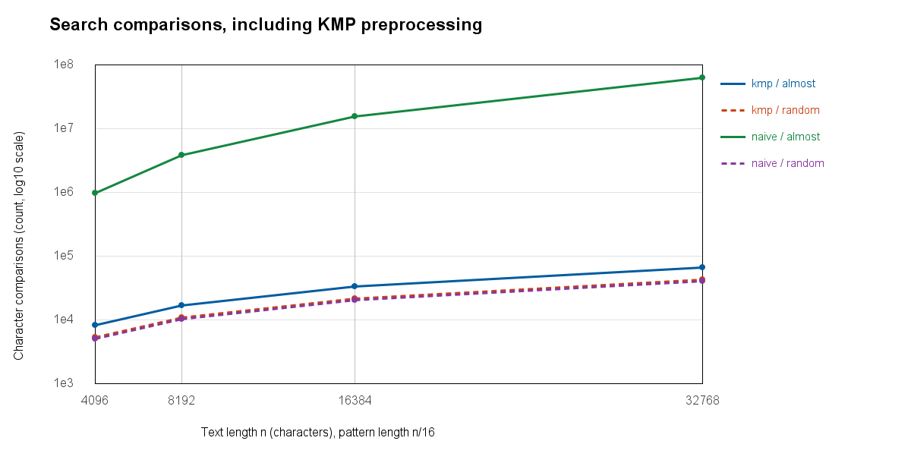

# Assignment 4: City Search & Spell-Check
Adilet Zhakubay, SE-2517

## Experiment Design Card (written before the runs)

| Field | Plan |
| --- | --- |
| Questions | Edit distance: how quickly does repeated recursion grow compared with DP, and does two-row DP save storage? Search: when does KMP avoid the comparisons repeated by naive search? |
| Sizes | Recursive distance: 2, 4, 6, 8, 10 (a 5x range, small enough for exponential work). Table and two rows: 64, 128, 256, 512, 1024 (16x range). Search text: 4096, 8192, 16384, 32768; pattern length n/16. Doubling sizes should make growth visible. |
| Inputs | Distance: independent random strings over abcd, and disjoint a^n / b^n to force three recursive branches at every non-base call. Search: random abcd text/pattern for early mismatches, and a^n with pattern a^(m-1)b for repeated almost-matches and no hits. |
| Metrics | Five timed runs after two warm-ups; save every run and use the median time in ms. Distance counts recursive calls or filled interior DP cells. Search counts character comparisons, including LPS construction for KMP. Also record allocated DP int slots to compare storage. |
| Prediction | Disjoint recursive distance will grow exponentially. DP cells will quadruple when n doubles, while two-row storage only doubles. Naive search will be near-linear on random input but quadratic on almost-matches because m grows with n. KMP should stay linear on both. |
| Plots | (1) Disjoint edit-distance work, logarithmic work axis; (2) DP storage, logarithmic slot axis; (3) search comparisons by input, logarithmic comparison axis; (4) median search time, logarithmic ms axis. Each plot answers the corresponding growth or storage question. |
| Reproduction | Java Random, seed 2517; generate each pair once before timing. The command reproduces inputs, answers and counters. Wall-clock times will vary between runs and machines. |

The plan was committed before measurement (`a701b91`). No input sizes or predictions were changed afterwards; the DP methods also ran on the small recursive inputs to give a direct comparison.

## Results and plots

The run used Java 27 on Windows amd64, with 8 available processors (see `results/environment.txt`). There are 330 rows in `results/results.csv`: five timed runs for each algorithm/input/size combination. Strings are generated outside the timer. Timing includes array allocation and counter updates; KMP timing and comparisons include building LPS. The two warm-up calls are excluded from the CSV.

Notice that recursive calls rise from 19 at n=2 to 12,146,179 at n=10, while both DP methods fill only 100 cells at n=10 (their lines overlap).

Notice that at n=1024 the table allocates 1,050,625 int slots, compared with 2,050 for two rows, about 512.5 times fewer.

Notice that doubling n almost quadruples naive almost-match comparisons but only doubles KMP comparisons, even when LPS work is included.

| Selected case | Measured work | Median time (ms) |
| --- | ---: | ---: |
| Recursive, disjoint, n=10 | 12,146,179 calls | 50.061100 |
| Table, disjoint, n=1024 | 1,048,576 cells | 9.862400 |
| Two rows, disjoint, n=1024 | 1,048,576 cells | 7.441600 |
| Naive, almost-match, n=32768 | 62,916,608 comparisons | 372.489700 |
| KMP, almost-match, n=32768 | 67,582 comparisons | 0.403500 |
| Naive, random, n=32768 | 41,204 comparisons | 0.797400 |
| KMP, random, n=32768 | 43,521 comparisons | 1.281500 |

## Prediction versus result

For edit distance, the work counters agree with the prediction. On disjoint strings, increasing recursive n by two multiplies calls by roughly 25-30 across the tested sizes. The table and two-row versions always fill n*m interior cells, so doubling equal lengths quadruples that counter. They do the same DP work but keep different amounts of information. At n=1024 random input, two rows actually took 16.866600 ms versus 10.972700 ms for the table, so smaller storage did not guarantee a faster measured run.

For search, the almost-match input shows the predicted gap. From n=4096 to n=32768, naive comparisons grow about 64 times, while KMP grows about 8 times. The final comparison ratio is about 931:1. On random input, naive needs slightly fewer comparisons than KMP because mismatches usually happen early and KMP pays for LPS. These results support linear KMP growth and show why its extra setup can be unnecessary on easy inputs. They do not show that KMP always has the best elapsed time.

## Short answers

**Which input made search slowest?** The repeated almost-match input made naive search slowest: a text of only a characters and a pattern ending with b. At each start, naive matches almost the entire pattern before failing at the last character. It then repeats those comparisons one position later, taking O(n*m) time. Because m=n/16 here, that becomes quadratic in n; with a fixed m, the interpretation would be different.

**How large could recursive edit distance handle?** The largest tested length was n=10 for each string, and the disjoint case already needed over 12 million calls. Its median was about 50 ms, so this was a practical stopping choice for the planned experiment, not a measured hardware limit. Repeatedly solving the same prefix pairs causes the growth, rather than a large stored table. I did not keep increasing n until a timeout or claim that n=11 is impossible. Matching strings can be much easier because matching last characters take just one recursive branch.

**What do two rows gain and lose?** Two rows reduce extra DP storage from O(n*m) to O(m), where m is the second string's length. My storage counter counts allocated int slots, not JVM array headers, references, stack frames or total process memory. The final distance stays the same and time remains O(n*m). The older rows are lost, so ordinary full-table backtracking cannot recover the edit sequence without additional work or a different reconstruction algorithm.

**Which search would I choose for the city platform?** I would choose KMP for long logs because repeated text should not make the search unexpectedly expensive. Its LPS array preserves useful prefix information after a mismatch and the text index never moves backwards. Naive search is simpler and can be competitive on short random input, as the measurements show. KMP gives a more predictable O(n+m) bound; edit distance would separately help rank street-name typos because exact KMP search does not perform fuzzy matching.

## Why time is not my only evidence

Times were nonzero but not smooth. For example, random naive search was faster at n=8192 than at n=4096, and KMP almost-match time decreased from n=16384 to n=32768 despite doubling comparisons. The additional [median-time plot](results/plots/search-time.png) makes these fluctuations visible. Two warm-ups and five runs reduce some noise but do not remove JVM compilation, scheduling, garbage collection or differences in branch behavior; the random cases also run earlier than the almost-match cases. These are instrumented single-call experiments, not precise microbenchmarks. Counters show stable growth on the same inputs, while medians describe this particular run. The storage results concern allocated DP slots only, and recursive calls and DP cells are different work units, so their ratio is not a predicted time speedup.
